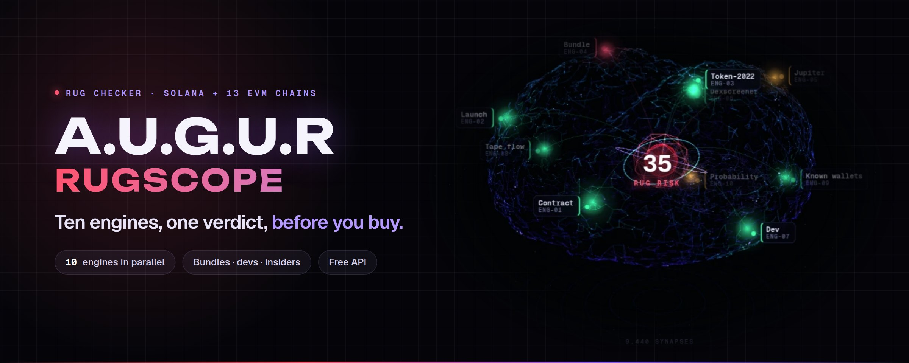
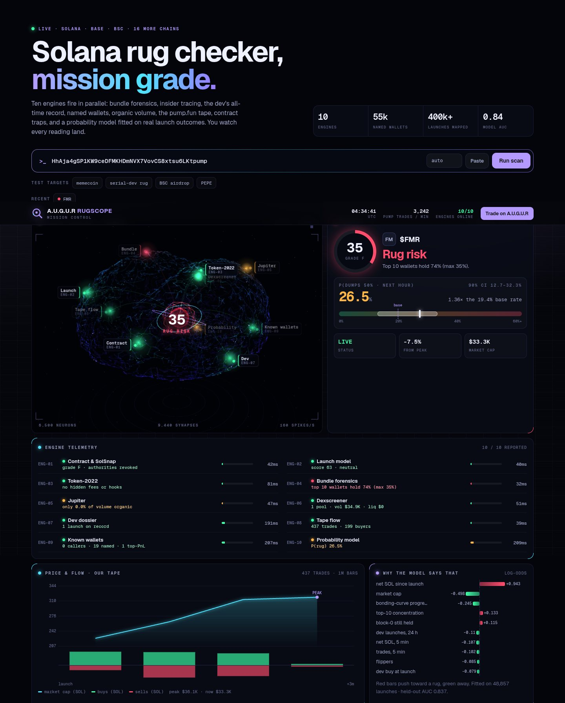
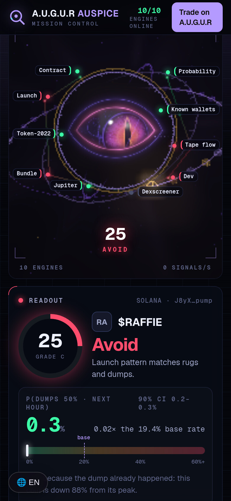
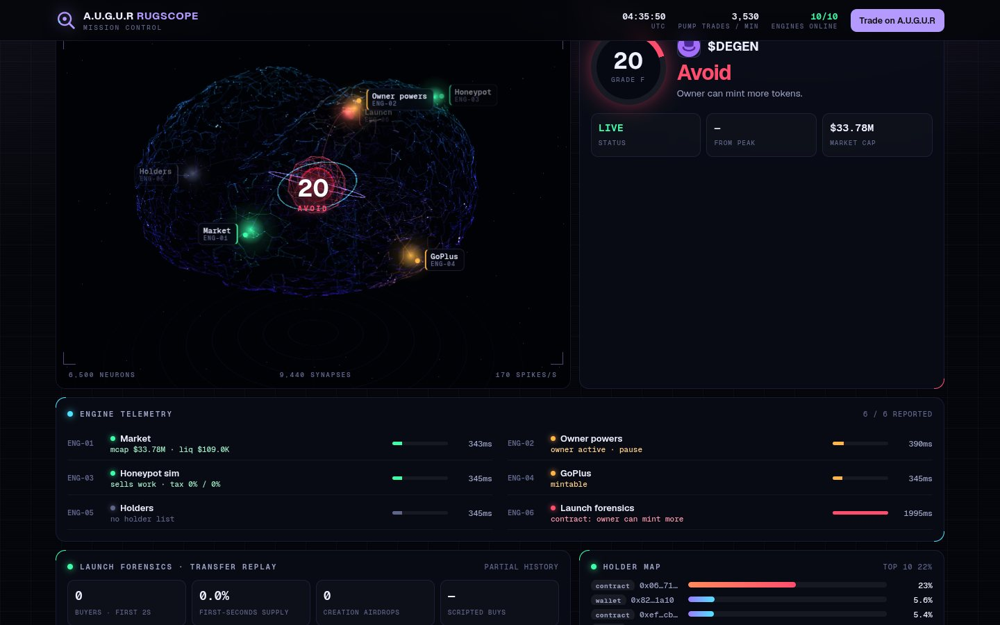

<p align="center">
  <a href="https://augur-trade.com/rug/"></a>
</p>

<p align="center">
  <a href="https://augur-trade.com/rug/"></a>
  <a href="https://x.com/AUGURtrading"></a>
  <a href="https://t.me/AUGUR_Trade"></a>
  <a href="docs/api.md"></a>
  <a href="docs/model.md"></a>
</p>

<p align="center"><b>Solana + 13 EVM chains</b> · <b>10 engines in parallel</b> · <b>~1 second</b> · <b>free</b></p>

<br>

**Auspice** is A.U.G.U.R's rug checker. Paste a token and ten engines fire at once: bundle forensics, insider
tracking, the dev's all-time record, named wallets, organic volume, our own pump.fun tape, contract traps and a
probability model trained on real launch outcomes. You watch every reading land, and you get one verdict.

> [!NOTE]
> This repository documents Auspice: what it checks, how it decides, the free scan API with real responses, and examples.
> The engines, data and model weights are closed source, so none of that is here.

<p align="center"><a href="https://augur-trade.com/rug/?q=HhAja4gSP1KW9ceDFMKHDmNVX7VovCS8xtsu6LKtpump"></a></p>

## What a scan tells you



**One verdict:** *Looks strong*, *Mixed*, *Rug risk*, *Avoid* or *Known asset*, with a 0–100 score and a grade.

**The checklist:** mint and freeze authority, Token-2022 traps (transfer fees, hooks, permanent delegate), mutable
metadata, liquidity, and on EVM the owner's powers plus a buy/sell honeypot simulation.

**The structure:** top-10 concentration, the block-0 bundle and what it still holds, tokens handed out without a buy, and insiders.

**The people:** the dev's every launch and how they ended, callers who called it, and profitable traders who are in or out.

**The odds:** for coins on the pump.fun curve, the chance of a 50% dump in the next hour (here **26.5%**,
range 12.7–32.3%, against a 19.4% base rate), and the reasons behind it.

<br clear="right">

## The engines

| Solana | | EVM (13 chains) | |
|---|---|---|---|
| **Contract** | Solana RPC | **Market** | Dexscreener |
| **Launch model** | our pump.fun tape | **Owner powers** | on-chain bytecode + calls |
| **Token-2022** | Solana RPC | **Honeypot simulation** | on-chain simulation |
| **Bundle forensics** | our tape + RugCheck | **GoPlus** | GoPlus Security |
| **Jupiter** | Jupiter | **Holders** | on-chain |
| **Dexscreener** | Dexscreener | **Launch forensics** | on-chain logs |
| **Dev dossier** | pump.fun |  | |
| **Tape flow** | our pump.fun tape |  | |
| **Known wallets** | our caller + wallet index |  | |
| **Probability model** | gradient-boosted model, our data |  | |

What each one checks: [docs/engines.md](docs/engines.md). How the verdict is decided and the rug-guard rules: [docs/verdicts.md](docs/verdicts.md).

<p align="center"></p>

## Free API

```bash
curl -s "https://augur-trade.com/hub/api/v1/rugscope?q=<token address>" | jq .readout.verdict
curl -sN "https://augur-trade.com/hub/api/v1/rugscope?q=<token address>&stream=1"      # watch each engine report live
```

No key and no signup: 20 scans a minute, 400 a day. Full reference with **real responses**: [docs/api.md](docs/api.md)

```js
import { passes } from './examples/node/pre-trade-gate.mjs';
if (await passes(mint)) await buy(mint);     // fails closed: no scan, no buy
```

## The model, honestly

The dump-probability model scores **0.837 AUC** on held-out launches and **0.753** on real Telegram caller calls.
It is a ranking aid, not a prophecy, and it only scores coins still on the bonding curve. [Model card →](docs/model.md)

## Use it

- **Site:** [augur-trade.com/rug](https://augur-trade.com/rug/) · deep link `?q=<address>` · [embed](docs/embed.md) with `?embed=1`
- **Token reports:** [augur-trade.com/rug/tokens](https://augur-trade.com/rug/tokens/)
- **In the A.U.G.U.R app:** a *Rug scan* on every token page, and the rug guard runs before every sniper buy
- **For AI agents:** the same engines are tools on [A.U.G.U.R Foresight](https://github.com/Augur-Trade/foresight) (`token_risk`, `launch_scan`, `bundle_forensics`, `evm_token_security`…)

| Path | |
|---|---|
| [`docs/`](docs) | [engines](docs/engines.md) · [verdicts](docs/verdicts.md) · [model card](docs/model.md) · [API](docs/api.md) · [embed](docs/embed.md) |
| [`examples/`](examples) | curl, Node (streaming + pre-trade gate), Python, browser EventSource, embed |
| [`spec/openapi.json`](spec/openapi.json) | the scan endpoint |

<br>

<p align="center"><sub><a href="https://augur-trade.com">augur-trade.com</a> · Auspice is part of A.U.G.U.R, the autonomous trading agent.<br>A scan is information, not financial advice. A clean scan does not mean a token can't go to zero.</sub></p>
